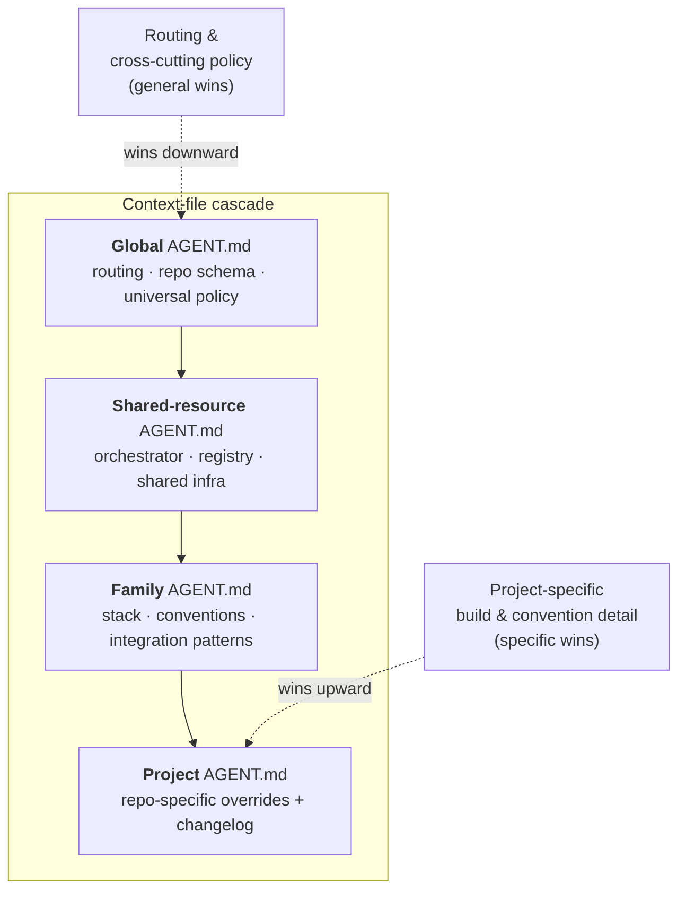

# The Context Cascade

> When a global rule, a team convention, and a project quirk all apply to the same task, the agent needs to know which one wins — *before* it has to guess. A declared precedence order across `AGENT.md` files makes the answer deterministic.

**Part of:** [AI Dev Governance](../README.md) · **Prerequisite reading:** [The Two Roles](two-roles.md)

> These per-directory instruction files are called `AGENT.md` here. In practice it's whatever your coding agent loads at startup — `CLAUDE.md`, `AGENTS.md`, `.cursorrules`, and so on. The cascade logic is identical regardless of the filename.

---

## The wall

One repo, one set of rules — easy. Twenty repos, and "the rules" are scattered: a global commit policy, a family-wide stack convention, one project that does a single thing differently. The agent reads them in no particular order and resolves conflicts by coin flip — applying a project-specific hack everywhere, or ignoring a project override because some family rule outranked it in the moment. Conflicting instructions with no declared precedence produce nondeterministic behavior, which is the exact opposite of governance.

## The rule

Declare a precedence order, and write it into the files themselves. Top to bottom:

1. **Global** — routing, the repo schema, universal policy.
2. **Shared resource** — governance for shared infrastructure, when the task touches it.
3. **Family** — stack, conventions, integration patterns for a group of repos.
4. **Project** — the most specific file; overrides the rest for that repo.

**More specific wins** for project detail; **more general wins** for routing and cross-cutting policy. Decide this once, up front — not in the middle of a conflict.

**Which way "wins" runs depends on the question:**

| The question is about… | Who wins | Why |
| :---- | :---- | :---- |
| Build/test/format/style detail for *this* repo | **Project** (most specific) | Only the project knows its quirks |
| Stack choice, integration pattern across the family | **Family** | The whole family shares it |
| Touching shared infrastructure (orchestrator, registry) | **Shared resource** | Cross-cutting governance must hold |
| Routing, security, commit discipline, universal policy | **Global** | These exist *to* override local convenience |

The two arrows in the diagram are the whole rule: **project-shaped questions resolve upward into specificity; policy-shaped questions resolve downward into generality.**

## How it works

Each level holds only what belongs at its scope. A rule that's true everywhere lives at Global; a rule true for one repo lives in that repo's `AGENT.md`. Conflicts resolve by the rule above: the project file wins on how *that* project is built; the global file still wins on policies that protect every project.

Each project's `AGENT.md` carries a **changelog** — the load-bearing memory of what shipped and why. Family files change only when a pattern proven in one project is **promoted** to a family-wide standard, with a pointer to the reference implementation. Promotion is deliberate; copy-paste drift is not.

## When a level outgrows its budget: a router, not an encyclopedia

Splitting by scope solves *which rule wins*. It doesn't stop any one level from growing, and the top level grows fastest, because every hard-won rule feels universal and every correction gets its story written next to it.

The scar is measured. One shop's global file reached **207 KB — about 80,000 tokens, loaded into every session and every subagent.** An earlier hand-trim had cut it to 42 KB; it grew back, because nothing stopped it. A fresh session started with 91,830 tokens of context before the operator typed a word. A repo-level file did worse: a 662 KB inline changelog was re-attached in full after every automatic context compaction, compaction fired every two minutes or so, and each cycle left only a fraction of the window for real work. The tool reported its own compaction as thrashing.

The fix is to make the top file a **router**: an index of triggers, with the substance one hop away.

1. **Each entry carries three things:** the moment it applies, the rule in one or two sentences, and a pointer to a section file. *"Before writing a webhook handler: classify the vendor; bad-signature responses differ by class. → `sections/16-webhooks.md`"*
2. **The full text — reasons, worked examples, correction history — moves verbatim** to one section file per rule. The router's opening paragraph states the contract: *when a section's trigger matches what you're about to do, read its file before acting.*
3. **What stays inline:** a rule whose absence causes a *confident wrong action with nothing erroring*, where the agent wouldn't know to go look it up; and any rule that must fire before any section file could be read. Everything else is trigger + rule + pointer.
4. **Write the trigger as the moment of the risky act, not the topic.** One review found the proposed triggers wrong in four of four sampled cases: *"before closing a defect"* had to become *"whenever you observe one"*; *"before any database operation"* had to become *"when changing public caching, adding a cron, or writing a health endpoint."* A rule that applies continuously can't be triggered, so it stays inline.
5. **Prove nothing was lost.** Move sections verbatim, then concatenate the section files in order and confirm they reproduce the old file byte for byte. Keep every heading, so external citations of a section still resolve.
6. **Give the file a ceiling that can only go down**, and enforce it with something other than discipline — a hook that blocks an edit adding narrative to the router, raising the ceiling, or removing the budget marker. The first hand-trim decayed because it was applied once, by hand.

The measured result: the same headless session started at 42,817 tokens instead of 91,830. In the repo file, moving the changelog out to one small file per entry — the `AGENT.md` keeping only the last ten one-line pointers — took the re-attached size from roughly 700 KB to 60 KB, and the first compaction moved from two minutes into the session to eighteen.

The same shape applies one level down: per-repo files keep the live rules plus a short pointer list of recent changelog entries, and the entries themselves live in their own files. A rule correction edits the rule in place; the story of the correction goes in the entry.

## Worked example

Task: format and commit a change in Project X.

- **Family standard:** "2-space indent."
- **Project X's `AGENT.md`:** "this repo uses tabs (legacy build tooling)."
- **Global:** "always type-check before commit."

Resolution: Project beats Family on indentation — specificity wins on project detail → **tabs.** Global still applies on top — cross-cutting policy wins → **run the type-check before committing.** No ambiguity, because the order was declared before the conflict arose.

## Anti-patterns

| Anti-pattern | Why it bites | Do instead |
| :---- | :---- | :---- |
| One giant rules file | Can't scope or override cleanly | Split by level; let specificity resolve |
| Duplicating a rule across levels | Copies drift; which is true? | State each rule once, at the right level |
| Editing the family file for a one-off | Pollutes every project in the family | Put the exception in the project file |
| No project changelog | The agent re-learns (and re-breaks) each session | Keep a changelog, as short pointers to per-entry files |
| Trimming the top file once, by hand | It regrows to the same size, because nothing stops it | A byte ceiling, enforced by a hook, that can only be lowered |
| The story of every correction written inline | Every session pays rent on history | One-sentence rule inline; the story behind the pointer |
| Triggers written as topics ("before any database work") | Fires too early or too late, and gets ignored | Trigger on the moment of the risky act |
| Hand-merging rules while splitting the file | A silent loss, with no way to prove there wasn't one | Move verbatim; prove conservation by re-joining |
| An inline changelog that grows forever | Re-attached in full after every compaction | Per-entry files; the context file keeps the last few pointers |

## Adapt it to your setup

- **Solo / one repo:** you may need exactly one `AGENT.md`. Don't build a four-level cascade for a single project — add levels only when repos start sharing conventions.
- **When to add a level:** the moment two repos copy-paste the same rule, that rule wants to live one level up.
- **Different tools:** the file may be `CLAUDE.md`, `AGENTS.md`, or `.cursorrules` — the precedence logic doesn't change.
- **When to adopt the router:** when a session starts measurably full before any work begins, or when your agent's compaction keeps re-attaching the same large file. Measure the session's starting token count before and after; don't assume the saving.
- **Agents that discover files differently:** some agents load instruction files only from the repo root downward. If your family-level files live above the repo root, check what each agent actually loaded rather than assuming — see [Enforcement, Not Attestation](enforcement.md#enforce-dont-attest).

## Related

- [The Two Roles](two-roles.md) — the Executor reads this cascade at startup
- [Governance Sync](governance-sync.md) — keeping shared cascade files aligned across roles
- [Durable Memory](durable-memory.md) — the cross-session knowledge store loads through the same indexed-cascade shape
- Back to the [main playbook](../README.md)
